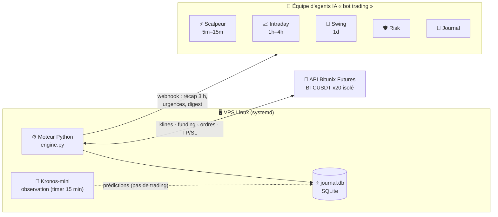

<div align="center">

# 🤖 Trading v4 — Agent IA de trading autonome

**Un moteur de trading crypto qui tourne 24/7 sur un VPS, exécute ses propres trades sur Bitunix et rend compte à une équipe d'agents IA.**


</div>

---

## ✨ Le pitch

Trading v4 est un **agent de trading autonome** : un moteur Python unique analyse BTCUSDT sur six unités de temps, détecte des setups, ouvre et protège ses positions (SL et TP par trade), se répare tout seul quand l'exchange annule un ordre, et coupe tout si le compte passe sous un seuil critique.

Il ne bavarde pas : il envoie à une **équipe d'agents IA** (Scalpeur, Intraday, Swing, Risk, Journal) des récapitulatifs groupés toutes les 3 heures, ce qui garde la supervision intelligente tout en économisant les tokens. En parallèle, **Kronos**, un modèle de fondation pour séries financières, est observé en silence pour mesurer s'il mérite un jour de filtrer les entrées.

## 🏗️ Architecture



| Composant | Rôle |
|---|---|
| `server/engine.py` | Boucle principale : données, indicateurs, signaux, exécution, protection, alertes |
| `server/trading-v4.service` | Unit systemd (redémarrage automatique) |
| `kronos/` | `observe.py` (prédictions), `stats.py` (taux de réussite), unit + timer systemd |
| `journal.db` | Signaux, trades, événements, alertes (non versionné) |

## 📐 Stratégie

- **Indicateurs** : EMA 20 / 50 / 200, RSI, ATR, VWAP, volume relatif, funding rate, ADX (v4.1), ATR %, pente OBV (v4.2).
- **Filtres v4.2** : ATR % minimum par TF (marchés plats écartés, seuils calibrés sur l'historique), breakout 5m strict (volume ≥ 2× la moyenne 20 + clôture au-delà), VWAP/OBV en bonus/malus de confiance, Kronos 1h (auto-activé seulement si précision ≥ 55 % sur ≥ 50 prédictions). Chaque rejet est journalisé dans `signals.skip_reason` (`filtre: …`).
- **Setups** :
  - `breakout` — cassure de niveau confirmée par le volume et l'ADX ;
  - `pullback_ema20` — retour sur l'EMA20 dans le sens de la tendance (EMA50/200) ;
  - `rsi_reversal` — retournement sur RSI extrême.
- **Timeframes** : 5m, 15m, 1h, 4h, 1d pour le trading ; le 1m reste en contexte.
- **Confiance** : chaque signal a un score ; trade au-dessus de `MIN_CONF_TRADE`, alerte au-dessus de `MIN_CONF_ALERT`.
- **Exécution** : entrée limite post-only au meilleur prix, annulée si non remplie en 20 s (jamais chassée) ; TP en limite, SL au marché.

## 🛡️ Gestion du risque

- Levier **x20 en marge isolée**.
- **Risque max 12 % de l'equity par trade** (`RISK_PCT=12`, v4.2 ; était 33 %), **plafonné par la marge** : 1/4 du compte maximum engagé par trade (`MAX_MARGIN_PCT=25`) — avec un petit compte c'est souvent ce plafond qui fixe la taille, donc le risque réel est en général bien inférieur à 12 %.
- SL à `ATR × 1,5` (minimum 0,41 %), **TP à 1,5R** ; **50 % fermés à 1R** (ordre limite), puis SL au **break-even + frais** (v4.2).
- Jusqu'à 2 positions par timeframe (`MAX_PER_TF=2`), 6 au total (`MAX_OPEN`).
- **Auto-kill** (v4.2) : un setup×TF perdant sur 3 jours (n ≥ 8, PnL < 0, WR < 40 %) passe en paper, puis est réactivé si son résultat paper sur 3 jours est positif.
- **Kill switch** : equity ≤ `KILL_EQUITY` → fermeture de tout et arrêt (HALT).
- **SL et TP par trade** même sur position fusionnée, avec **réparation automatique** : TP/SL annulé par Bitunix → re-posé ; SL impossible à re-poser → fermeture au marché de la seule part du trade ; alerte urgente.
- Frais plafonnés à 20 % du risque (`MAX_FEE_SHARE=0.20`), estimés maker à l'entrée post-only et taker à la sortie.

## 💸 Économie de tokens

L'équipe d'agents n'est pas réveillée à chaque événement :
- **récap groupé toutes les 3 h** (ouvertures, clôtures, setups) ;
- urgences regroupées à la minute ; kill switch toujours immédiat ;
- **un digest par jour** (14:00 UTC+8) ;
- plafonds journaliers d'alertes et cooldowns.

## 🏷️ Versions

| Tag | Date (UTC+8) | Résumé |
|---|---|---|
| `v4.0` · `v4.0-paper` | 21/10/2026 | Premier moteur, paper par défaut |
| `v4.0-live` · `v4.0.1` | 21/10/2026 | Passage en réel, marge de sécurité frais |
| `v4.0.2` | 21/10/2026 | Fermeture partielle sur position fusionnée |
| `v4.0.3` | 22/10/2026 | Suivi des TP/SL en attente |
| `v4.0.4` | 22/10/2026 | Webhook fiable (retries, événements jamais plafonnés) |
| `v4.0-stable` | 22/10/2026 | TP/SL par trade + réparation — version de référence |
| `v4.1` | 23/10/2026 | Récaps 3 h, filtre ADX, entrées post-only, 1m retiré |
| `v4.1.1` | 23/10/2026 | Réparation automatique du SL |
| `v4.1.2` | 23/10/2026 | Revue de performance 3 jours sans tokens |
| `v4.2` | 23/10/2026 | TP 1,5R + partielle 1R + BE, frais 20 %, risque 12 %, filtres ATR%/VWAP-OBV/Kronos, auto-kill |
| `v4.2.1` | 23/10/2026 | SL/TP modifiés en place après la partielle (jamais sans SL) — **en production** |

Changelog détaillé : [CHANGELOG.md](CHANGELOG.md).

## 📊 Résultats réels

Chiffres lus dans `journal.db` (mode LIVE, du 21/10/2026 03:00 au 23/10/2026 00:55 UTC+8), sans extrapolation :

| Timeframe | Trades clôturés | Gagnants | Perdants | PnL net (USDT) | Frais (USDT) |
|---|---:|---:|---:|---:|---:|
| 1m | 31 | 11 | 20 | −2,38 | 5,05 |
| 5m | 13 | 9 | 4 | +3,56 | 2,26 |
| 15m | 7 | 6 | 1 | +4,67 | 1,55 |
| 1h | 1 | 1 | 0 | +1,51 | 0,15 |
| **Total** | **52** | **27** | **25** | **+7,36** | **9,02** |

Par setup : `breakout` 36 trades (+3,75 USDT), `pullback_ema20` 18 trades (+3,61 USDT) (2 trades encore ouverts inclus dans ces comptes).
**Equity : 26,62 USDT au départ → environ 34 USDT** (34,79 au dernier heartbeat).

> Échantillon très court (≈ 2 jours) : ces chiffres ne préjugent en rien des performances futures. Le 1m, seul timeframe perdant, a été retiré du trading en v4.1.

## 🚀 Installation

```bash
sudo useradd -r -m -d /opt/trading-v4 trader
sudo -u trader git clone https://github.com/Dontbyshai/trading-v4.git /opt/trading-v4
cd /opt/trading-v4/server
sudo -u trader python3 -m venv venv && sudo -u trader venv/bin/pip install -r requirements.txt
sudo -u trader cp ../.env.example .env && sudo chmod 600 .env   # puis éditer
sudo cp trading-v4.service /etc/systemd/system/
sudo systemctl daemon-reload && sudo systemctl enable --now trading-v4
journalctl -u trading-v4 -f
```

Kronos (optionnel, observation seule) : copier `kronos/` dans `/opt/kronos`, créer le venv, puis installer `kronos/systemd/kronos-observe.{service,timer}` et `systemctl enable --now kronos-observe.timer`.

## ⚙️ Configuration

Tout passe par `.env` (modèle : [`.env.example`](.env.example)). Points clés :

| Variable | Rôle |
|---|---|
| `DRY_RUN` / `LIVE` | Ordres réels seulement si `LIVE=1` **et** `DRY_RUN=0` |
| `LEVERAGE`, `MAX_MARGIN_PCT`, `KILL_EQUITY` | Levier, marge max par trade, seuil du kill switch |
| `TRADE_TIMEFRAMES` | Timeframes autorisés à trader |
| `BITUNIX_API_KEY/SECRET` | Clés **sans droit de retrait**, IP whitelistée |
| `WEBHOOK_URL/KEY` | Point d'entrée de l'équipe d'agents |
| `WEBHOOK_BATCH`, `BATCH_HOURS` | Récaps groupés |
| `ADX_FILTER`, `ENTRY_POST_ONLY`, `TP_LIMIT` | Nouveautés v4.1 (0 = désactivé) |
| `RISK_PCT`, `RR`, `PARTIAL_TP`, `BE_AFTER_PARTIAL`, `MAX_PER_TF` | Risque 12 %, TP 1,5R, partielle 50 % à 1R, BE + frais (v4.2) |
| `ATR_FILTER`/`ATR_MIN_PCT`, `BREAKOUT5M_STRICT`, `VWAP_OBV`, `KRONOS_FILTER`, `AUTO_KILL` | Filtres et auto-kill v4.2 (0 / off = désactivé) |

> ⚠️ Ne jamais committer `.env` ni `journal.db` (déjà dans `.gitignore`).

## ⏪ Retour arrière

```bash
cd /opt/trading-v4 && git fetch --tags
git checkout v4.0-stable -- server/engine.py    # ou n'importe quel tag
sudo systemctl restart trading-v4
```

Les nouveautés v4.1 et v4.2 se désactivent aussi une par une dans `.env`, sans changer de code.

## 🗺️ Roadmap

- [ ] **Copy trading Bitunix** (devenir lead trader)
- [ ] **Multi-paires** (ETH, SOL…)
- [ ] **Backtest** sur l'historique des klines avec les mêmes règles
- [x] **Filtre Kronos** 1h (v4.2, auto-activé si précision ≥ 55 % sur ≥ 50 prédictions)

## ⚠️ Avertissement

Ce projet est expérimental. Le trading de contrats à terme avec effet de levier (x20) comporte un **risque élevé de perte totale du capital**. Rien ici n'est un conseil en investissement. Les résultats passés, sur un échantillon court, ne garantissent pas les résultats futurs. N'engagez que des sommes que vous pouvez perdre.

## 📄 Licence

© 2026 Dontbyshai — **Tous droits réservés.** Code propriétaire : toute copie, modification ou redistribution est interdite sans autorisation écrite.

## Revue de performance (v4.1.2)
`review.py` (stdlib, DB en lecture seule) analyse les 3 derniers jours + l'historique : PnL, WR, PF, moyennes, drawdown, frais, ventilation setup/TF/sens/sortie, verdicts ✅/⚠️/❌ (n≥8), recommandations et précision Kronos. Rapport : `/opt/trading-v4/reviews/latest.md`. Timer systemd `review/trading-v4-review.timer` (`*-*-01/3 05:30 UTC` = 13:30 UTC+8, Nice=10, MemoryMax=200M).
